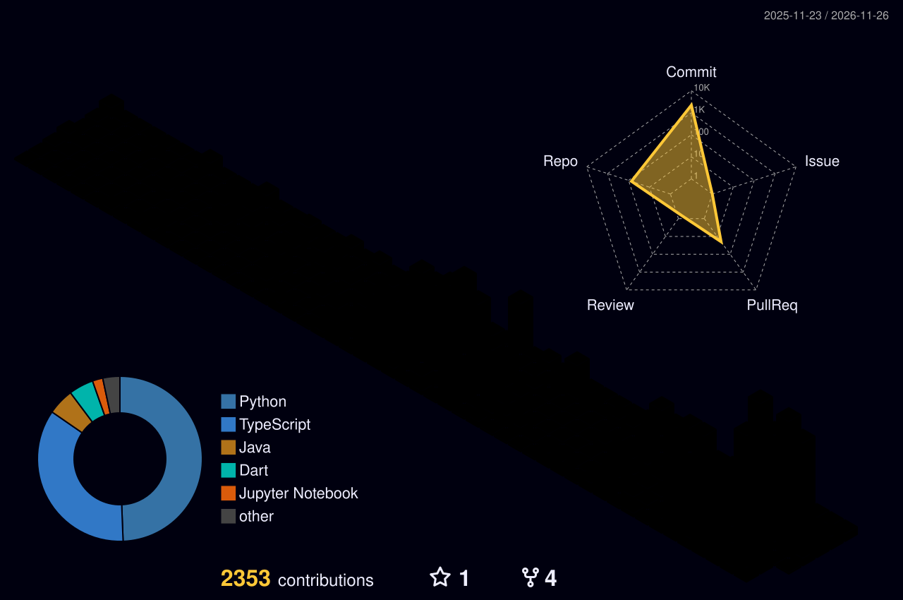

<!-- Header -->
<p align="center">
  
</p>

<p align="center">
  <a href="https://git.io/typing-svg">
    
  </a>
</p>

<p align="center">
  <a href="https://www.linkedin.com/in/nandakishorsp/"></a>
  <a href="mailto:nandakishor.sp.2k7@gmail.com"></a>
  
</p>

---

## 👋 About me

<table>
<tr>
<td width="55%" valign="top">

I'm a **third-year Computer Science and Engineering student** at **Saveetha Engineering College, Chennai**.
I build **reliable, explainable software** for safety-critical and public systems, mostly through hackathons and competitions.

- 🧠 **Into:** multi-agent AI, applied ML, AI fairness and safety
- 🛠️ **Build with:** Python, Java, TypeScript · Next.js · FastAPI · Spring Boot
- 📈 **Daily habit:** DSA in Java → [leetcode-daily-progress](https://github.com/MrNK2107/leetcode-daily-progress)
- 🤝 **Open to:** AI / backend internships and open-source collaborations

</td>
<td width="45%" valign="top">

```ts
const nanda = {
  location: "Chennai, India",
  focus: ["multi-agent AI", "full-stack"],
  shipping: ["PACT", "RailSaathi",
             "SentinelAI", "BIAS-0"],
  nextUp: [
    "deploy 2 projects to real users",
    "system design fundamentals",
    "AI / backend internship",
  ],
};
```

</td>
</tr>
</table>

## 🛠️ Tech stack

<p align="center">
  
  <br/>
  
  <br/>
  
  <br/><br/>
  
  
  
  
</p>

## 🚀 Featured projects

<p align="center">
  <a href="https://github.com/MrNK2107/PACT"></a>
  <a href="https://github.com/MrNK2107/RailSaathi"></a>
  <br/>
  <a href="https://github.com/MrNK2107/SentinelAI"></a>
  <a href="https://github.com/MrNK2107/BIAS-0"></a>
</p>

## 📊 GitHub analytics

<p align="center">
  
  
</p>

<p align="center">
  
</p>

<p align="center">
  
</p>

<p align="center">
  
</p>

<p align="center">
  <picture>
    <source media="(prefers-color-scheme: dark)" srcset="https://raw.githubusercontent.com/MrNK2107/MrNK2107/output/github-contribution-grid-snake-dark.svg"/>
    <source media="(prefers-color-scheme: light)" srcset="https://raw.githubusercontent.com/MrNK2107/MrNK2107/output/github-contribution-grid-snake.svg"/>
    
  </picture>
</p>

<p align="center"><i>"The psyche is an algorithm. Debug it, or be run by it."</i></p>


